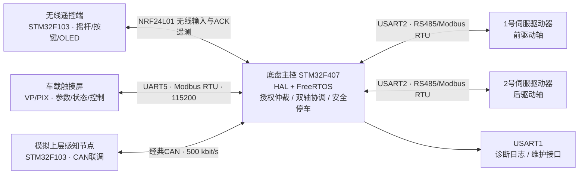

# 同济大学轨道巡检车控制系统（无机械臂应用版）

**Track Inspection Vehicle · Chassis, Remote Controller, On-board HMI & CAN Upper-layer Simulator**

本仓库汇集轨道巡检车的四端协同控制工程：STM32F407 底盘主控、STM32F103 无线遥控端、车载触摸屏，以及 STM32F103 模拟上层感知节点的 CAN 联调端。系统面向 1435 mm 标准轨距车辆，以双轴伺服驱动、统一运动授权、速度协调、状态遥测和故障停车为核心，为底盘调试、上层接口开发和整车联调提供工程基线。

本次归档来自 `备份代码1110` 的完整工作目录快照，整理日期为 **2026-11-14（北京时间）**。保留源码、Keil 工程、HAL/CMSIS/FreeRTOS 依赖、屏端原始工程、固件、测试脚本、验证记录及历史交付资料。发布清单见 [SNAPSHOT_MANIFEST.json](SNAPSHOT_MANIFEST.json)，其中记录每个原始文件的大小及 SHA-256。

> **工程定位：**本版主要覆盖车辆行走与双轴伺服控制。CAN 模拟端用于替代真实上层节点验证协议和控制链路；仓库未提供完整的视觉识别、定位建图或自主巡检感知算法。软件测试、构建记录及历史现场资料分别保留，具体版本的实车通过情况须以对应验收记录为准。

## 1. 系统架构



F407 是双轴伺服的执行与安全管理中心。遥控器、车载屏和 CAN 上层节点提供操作意图，主控统一完成控制权判定、会话与期限校验、公共速度轨迹、双轴补偿及驱动事务。遥测经统一状态快照分发至三类终端，各端显示目标值、已下发命令和实际反馈时保留有效性及数据年龄。

**轴定义：**当前双轴同步设计针对前、后驱动轴。部分源码沿用 `LEFT/RIGHT`、A1/A2 命名，应结合从站地址和实车接线确认映射；不应将其直接理解为左右差速转向控制。

## 2. 工程目录与版本基线

```text
.
├── README.md
├── SNAPSHOT_MANIFEST.json
├── RailInspectionCar_Inno_1110/
│   └── RailInspectionCar_Inno_V1/        # F407 底盘主控
├── Remote_control _1110/
│   └── Remote_control/                  # F103 无线遥控器
├── 06_Upper_level_CAN_com_1110/
│   └── 06_Upper_level_CAN_com_v1.1_low_speed_test/
│                                        # F103 CAN 上层模拟与运动测试端
└── 37_轨道巡检车HMI链路双侧取证版/          # 车载屏 PIX、BIN、脚本与验证资料
```

| 子系统 | 主入口 | 归档时原子仓库 HEAD | 原分支 |
| --- | --- | --- | --- |
| 底盘主控 | [RailInspectionCar_V1.uvprojx](RailInspectionCar_Inno_1110/RailInspectionCar_Inno_V1/MDK-ARM/RailInspectionCar_V1.uvprojx) | `a75849554465861d5df21236813ef4dfb746c678` | `fix/hmi33-scheduling-session` |
| 无线遥控端 | [Remote_control.uvprojx](<Remote_control _1110/Remote_control/MDK-ARM/Remote_control.uvprojx>) | `4069b322b57bbe4412f924b347dfed12e85b3a15` | `main` |
| CAN 上层模拟端 | [DigitalElectronicseCode.uvprojx](06_Upper_level_CAN_com_1110/06_Upper_level_CAN_com_v1.1_low_speed_test/MDK-ARM/DigitalElectronicseCode.uvprojx) | `10446a63ad02bb6085876359ca97b14c1badaa35` | `master` |
| 车载屏 | [17_轨道巡检车.pix](37_轨道巡检车HMI链路双侧取证版/17_轨道巡检车.pix) | 本快照内未发现独立 Git 仓库；以文件哈希追溯 | — |

以上提交号用于说明导入来源；本仓库采用普通文件汇总，三个工程的本地 Git 历史未作为子模块导入。三端归档时工作区均干净；完整版本信息与逐文件哈希见快照清单。CAN 端 `10446a6` 已归档 `CANSTOP_20261109_R2` 固件及停车首因验证日志。

**版本选择原则：**历史资料中的旧工程编号、绝对路径、默认开关和固件哈希只代表当时交付。屏端顶层旧 `README.md` 仍包含 31 号说明，当前 37 号入口应参阅 [37号交付与日志说明](37_轨道巡检车HMI链路双侧取证版/37号交付与日志说明.md)。归档中另有专项实验和回退工程，常规开发优先使用上表三个正式 Keil 入口及屏端根目录 PIX。

## 3. 底盘主控：STM32F407

底盘工程采用 **STM32F407VG + STM32 HAL + FreeRTOS**，按应用、设备、协议和板级驱动分层。主要实现包括：

- **双伺服通信与运行管理：**通过 USART2 共用 RS485 总线，以 Modbus RTU 访问两个伺服驱动器；默认从站地址为 1、2，当前串口为 **115200 / 8N1**。处理参数配置与读回、使能、速度写入、故障及反馈轮询、超时和重试。
- **统一授权与控制仲裁：**管理遥控、HMI、CAN 和维护 CLI 等来源，同一时刻仅允许一个有效运动所有者。通过启动身份、会话、授权代次、序号及输入期限隔离旧命令。
- **双轴运动协调：**将有效目标转换为共同轮轴速度轨迹，结合两轴实际转速及反馈质量计算差动补偿，再进行联合限幅、方向和加减速约束，输出各驱动器整数 rpm 命令。
- **状态与里程监测：**采集轴速度、位置、使能、故障和诊断质量；依据机械参数推算车辆速度及行程，向屏、遥控器和 CAN 提供统一投影。
- **保护与恢复：**覆盖启动零速核验、运动授权、换向过零、目标过期、通信失联、反馈异常、跨来源停车和人工恢复，避免链路重建后重放旧目标。
- **维护与诊断：**保存链路、启动和停车首因，提供 USART1 日志及按配置启用的 CLI/调参接口；支持 LCD、人工 CLI 和脉冲功能的资源裁剪。

主要源码入口：`APP/app_dual_axis_motion.*`、`APP/app_can_control.*`、`APP/app_remote_servo.*`、`APP/HMI/`、`APP/app_system_snapshot.*`、`APP/app_position_monitor.*`，以及 `Device/`、`Protocol/` 和 `BSP/`。

### 3.1 双轴控制链与默认算法

```text
有效来源目标
  → 授权 / 会话 / 序号 / 新鲜度校验
  → 公共轮轴速度轨迹
  → 双轴反馈配对与同步补偿
  → 双轴联合速度、方向和加减速约束
  → 整数电机 rpm 与批次锁存
  → RS485 / Modbus 写入及反馈核验
```

当前源码默认采用**线性轨迹与 P 同步补偿**。S 型轨迹及 PI 为可选实现，`APP_DUAL_S_ENABLED=0`、`APP_DUAL_PI_ENABLED=0`；启用前需提供有效参数并完成标定与验收。正常行走路径采用 RS485 速度模式，脉冲控制代码作为可选路径保留，当前源默认 `APP_SERVO_PULSE_ENABLED=0`。

名义轮径为 **185 mm**，电机与轮轴传动比为 **8/3**。这些参数用于单位换算及速度/里程估算，不能替代轮径、传动方向、轮轨滑移和负载标定。两台电机的编码器转速也不能独立证明实际车辆地速。

设计依据见 [双轴同步与在线速度规划 V1.3](RailInspectionCar_Inno_1110/RailInspectionCar_Inno_V1/Docs/双轴同步V1.3_20261030/方案文档/轨道巡检车前后驱动轴动态同步与在线S型速度规划最终方案_V1.3_20261030.md)。

### 3.2 当前源默认资源配置

以下值来自归档时 `APP/app_config.h`；专项固件可能采用不同宏组合，应结合对应配置清单及固件哈希辨认。

| 项目 | 源默认 |
| --- | --- |
| CAN 通信 / CAN 运动控制 | 开启 |
| HMI 运动控制 | 开启 |
| 底盘 LCD | 开启 |
| 人工调试 CLI / UART 调参 / 伺服脉冲 | 关闭 |
| CAN 伺服诊断 / RS485 诊断 | 开启 |
| HMI 链路专项诊断 | 关闭；与 37 号屏双侧取证联调时须核对配套诊断构建 |

USART1 自动诊断与人工 CLI 的开关独立。详细资源配置见 [SRAM 与资源裁剪说明](RailInspectionCar_Inno_1110/RailInspectionCar_Inno_V1/Docs/F407_SRAM_20261108/README.md)，当前 CAN 时效改进见 [CAN 状态回传时效修复](RailInspectionCar_Inno_1110/RailInspectionCar_Inno_V1/Docs/CAN_TIMING_20261108/实施与验收.md)。

## 4. 无线遥控端：STM32F103 + NRF24L01 + OLED

遥控端采用 **STM32F103C8**，采集四路摇杆和按键事件，通过 NRF24L01 向底盘上传输入，并利用 ACK 遥测接收主控确认状态。遥控器负责输入采集与显示，运动模式、授权和最终目标由 F407 管理。

- **JOY 摇杆模式：**授权后默认进入 JOY，使用既有摇杆映射；重新授权或无线重建时清除旧按键目标。
- **KEY 按键调速模式：**满足摇杆回中门禁后通过 K9 切换；K1/K2 以 **0.05 km/h** 为步进调整公共目标，目标范围 **−20.00～+20.00 km/h**。这是软件目标范围，实际速度仍受主控斜坡、驱动器、机械及现场限值约束。
- **受控模式切换：**KEY 返回 JOY 需经过清零、主控零命令确认和两轴新零速反馈，再由操作员确认，不直接切换并恢复旧目标。
- **停车与授权：**保留 K5 对应的运动授权/停车操作，失联、撤权和重新建链继续经过主控保护流程。
- **中英文 OLED：**支持 K7 长按切换语言，K7/K8 短按翻页；提供目标与实际速度、控制源、双伺服状态、位置里程、同步质量、通信年龄和输入诊断等显示。

说明入口：[摇杆/按键双模式调速](<Remote_control _1110/Remote_control/Docs/遥控摇杆按键双模式调速_20261101.md>)、[OLED 中英文切换](<Remote_control _1110/Remote_control/Docs/OLED_Bilingual_20261103.md>)。

## 5. 车载屏端：操作、监视与链路取证

屏端采用 **VP/PIX 可编辑工程**，正式入口为 `37_轨道巡检车HMI链路双侧取证版/17_轨道巡检车.pix`，同目录 `.pix.bin` 为对应下载文件。通过 **UART5、115200 / 8N1、Modbus RTU** 与 F407 交换控制邮箱、业务结果和状态寄存器。

主要能力包括运行与诊断页面、双轴状态、速度与里程、伺服控制、目标输入、授权与停车操作，以及继承的日夜主题和跨页访问。页面切换不代替授权操作；显示刷新依赖主控发布序号、字段有效性和数据年龄，不应将缓存重发解释为新反馈。

**37 号工程增加链路异常双侧取证：**在运行异常分支清目标/会话前冻结首次现场，保存原因位、原始回复、boot/session、发布序号和目标年龄等；仅在停车确认且没有待处理控制事务时低频上传诊断页，停车和新授权保持优先。详细协议、脚本入口及该版本的验证边界见 [37号交付与日志说明](37_轨道巡检车HMI链路双侧取证版/37号交付与日志说明.md)。

本目录保存了多个历史版本的脚本和回退资料。维护当前 PIX 前应先核对版本说明，避免旧版生成/重建脚本覆盖当前事件绑定和资源。

## 6. 模拟上层感知 CAN 端：协议与双轴运动联调

该工程使用 **STM32F103C8 + CAN 收发器 + OLED/按键**，模拟真实上层感知/计算节点与底盘的通信和运动控制行为。当前是**具备运动控制能力的测试端**，不是早期只读版本；不直接驱动本地电机，不运行图像识别、相机采集或定位算法。

### 6.1 链路与控制流程

- **总线与协议：**500 kbit/s 经典 CAN，标准数据帧；通过启动公告、启动身份、分段邀请、会话确认和连续新心跳完成建链。
- **记录传输：**支持基本遥测及分段记录，校验 CRC、令牌、长度、序号和期限，区分 CAN 发送完成、业务受理与动作执行结果。
- **授权与首零：**申请运动授权，等待受理/完成结果和新的 `motion_token`，首个速度目标为零并经主控确认后再进入调速。
- **速度发送：**通过 `0x111` 周期发送带新序号的目标，默认刷新 **100 ms**、目标租期 **300 ms**；运动由 F407 转换为双轴伺服命令执行。
- **低速测试范围：**当前 `UPPER_LOW_SPEED_MAX_RPM=400`，按本地档位选择目标后发送；正常停车、换向过零及超时保护由两端状态机协同处理。
- **停车核验与首因：**当前构建标识为 `CANSTOP_20261109_R2`，提供 `STOP_FIRST` / `STOP_FAIL` 现场保留、UART 失败重试及身份异常区分。速度为零不自动等同于控制权已释放。

控制命令主要使用 `0x110`，速度目标使用 `0x111`，受理和完成结果使用 `0x120/0x121`；字段语义及编码以工程内协议实现和专项说明为准。

### 6.2 当前关键参数

| 参数 | 当前配置 |
| --- | --- |
| CAN 波特率 | 500 kbit/s |
| 速度目标刷新 / 租期 | 100 ms / 300 ms |
| 主控 CAN 心跳周期 / 链路失效期限 | 100 ms / 1000 ms |
| 模拟端控制记录年龄门禁 | 500 ms |
| 停车确认期限上限 | 30000 ms |
| USART1 | 115200 / 8N1；默认 SUMMARY，RAW 关闭 |

配置入口为 `APP/can_upper_config.h`。历史 `README_上层CAN模拟.md` 中的只读能力声明、禁发运动命令等描述属于旧基线，当前行为以代码、[低速版操作说明](06_Upper_level_CAN_com_1110/06_Upper_level_CAN_com_v1.1_low_speed_test/交付与操作说明_20261019.md) 的后续修订及 [CANSTOP R2 说明](06_Upper_level_CAN_com_1110/06_Upper_level_CAN_com_v1.1_low_speed_test/Docs/CANSTOP_20261109.md) 为准。模拟端与真实上层控制器应按角色规划接入，不能同时冒用同一个上层会话。

## 7. 构建环境与使用入口

| 工程 | 芯片 / 目标 | 开发环境 |
| --- | --- | --- |
| 底盘主控 | STM32F407VG / `RailInspectionCar_V1` | Keil MDK 5，ARM Compiler 5.06 update 7 |
| 无线遥控端 | STM32F103C8 / `Remote_control` | Keil MDK 5，ARM Compiler 5.06 update 7 |
| CAN 上层模拟端 | STM32F103C8 / `DigitalElectronicseCode` | Keil MDK 5，ARM Compiler 5.06 update 7 |
| 车载屏 | `17_轨道巡检车.pix` | 与该 PIX 格式匹配的 VP 工程编辑与编译环境 |

1. 克隆仓库，按第 2 节打开对应正式工程；路径含中文和空格，脚本调用时使用引号。
2. 核对 MCU、目标、依赖包、自定义 scatter 文件和宏配置后执行 Rebuild。
3. 使用当前构建生成的固件，核对路径及 SHA-256；不要仅凭文件名或历史文档选择 HEX/BIN。
4. 先完成通信和零速状态核验，再进行授权、低速双轴运行、停车和异常恢复联调。

三个主输出分别位于各自工程的：

```text
MDK-ARM/RailInspectionCar_V1/RailInspectionCar_V1.hex
MDK-ARM/Remote_control/Remote_control.hex
MDK-ARM/DigitalElectronicseCode/DigitalElectronicseCode.hex
```

F103 CAN 工程保留 Flash 启动计数页，下载时应遵循其自定义 scatter 与烧录说明，避免整片擦除破坏持久身份。CubeMX 再生成也须复核用户应用入口、RTOS 配置及 Keil 源码组。

## 8. 测试、诊断与验收资料

仓库包含生产协议/状态机的主机回归、边界与回绕测试、CAN 双端联合测试、遥控编解码和 OLED 测试、HMI 页面/事件核验，以及 Keil 构建、资源和固件哈希记录。常用入口如下，均应在对应子工程目录执行：

| 子系统 | 验证入口示例 |
| --- | --- |
| 底盘主控 | `Tests/run_tests.ps1`、`Tests/run_system_snapshot_tests.ps1`、`Tests/run_sync_storage_tests.ps1`、`Tests/run_boot_regression.py` |
| 无线遥控端 | `Tests/run_remote_tests.ps1`，可选 `-RenderPreview` |
| CAN 模拟端 | `Tests/run_tests.ps1`、`Tests/run_oled_tests.ps1`、`Tests/build.ps1` |
| 37 号车载屏 | `node --test hmi37.test.cjs hmi37-inherited.test.cjs hmi37-diag.test.cjs`、`python verify37.py` |

部分测试依赖本机编译器、Node.js、Python、PowerShell 或 VP 环境，部分脚本会生成验证输出，运行前请阅读对应脚本与说明。本次仓库整理完成文件完整性核验，未重新执行整套固件编译、全部回归或实物烧录。

现场验收应同时保存原始日志、固件哈希、操作步骤及视频时间点，重点覆盖授权首零、双向低速、双轴反馈、跨页/调速、K5/K3 停车、目标过期、断线/重启、Bus-off、重新授权及持续运行。软件停车能力须结合独立硬件停机措施进行整车验证。

## 9. 归档与维护说明

- 本仓库纳入原目录全部 **4,658 个文件**，包括被原子工程 `.gitignore` 忽略的构建产物和历史证据，原始文件字节保持一致；另外新增根 README、快照清单及归档属性文件。
- 子工程 `.git` 属于本地版本控制元数据，不作为工作文件上传；原仓库保持原样。本仓库可直接获取四端文件，无须初始化 Git 子模块。
- Git 不保存空目录；清单单独记录原始空目录。原始文件、大小、SHA-256 和来源提交的核对以 `SNAPSHOT_MANIFEST.json` 为准。
- 这是完整协作资料快照，部分历史验证脚本和说明包含原机器的绝对路径，移机使用时需要按本机环境调整。
- 代码中保留 ARM3 等兼容扩展及历史资料，表示软件接口仍可追溯，不代表本无机械臂应用版已部署或验收相应实体设备。
- 后续改动建议按四端协议兼容关系一起记录源码提交、宏配置、构建结果、固件哈希和现场验收结果。
