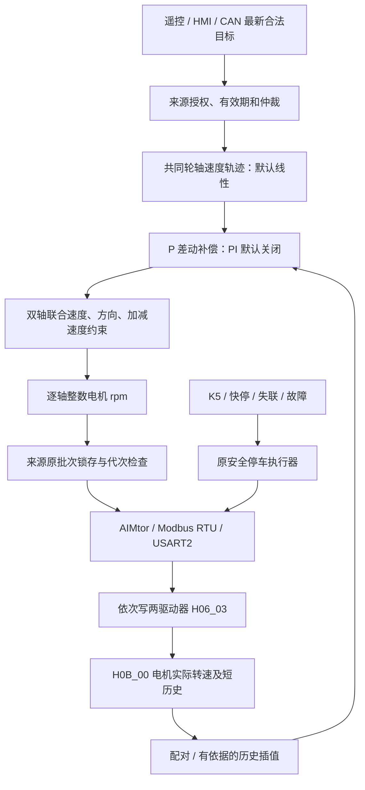

# 轨道巡检车前后驱动轴动态同步与在线 S 型速度规划最终方案

版本：V1.3  
日期：2026-10-30（本机工作区日期；用户会话日期 2026-10-29）  
项目：同济大学 1435 标准轨距轨道巡检车，STM32F407 / RS485 速度模式  
状态：线性/P 软件候选版已实现；S、PI 已实现可选算法，默认关闭；实物验收未完成。

## 1. 决策、适用范围与证据边界

保留现有 RS485 速度模式。每次获得授权后，活动来源只维护一个共同轮轴角速度轨迹，在此轨迹之后执行前后反馈差动协调和双轴联合约束，最后量化为整数电机 rpm，交由现有 Modbus 批次执行。三个来源调用同一个纯 C 协调模块，不增加 RTOS 任务；仲裁器保证同一时刻只存在一个有效运动所有者。

同步对象为**方向及传动比归一化后的前后轮轴转速**。同步优先于共同到速时间，允许两轴共同进度放缓。有效轮径仅用于滚动线速度监视、里程及机械校核。首版 Ki=0，不直接提高现有 Kp。S 模式没有隐含 jerk；只有明确设置有效参数并显式打开开关后才可运行。

本文件替代旧文档中重复且互相冲突的实施描述。旧文件名含 V1.0、正文为 V1.2 的文件原样保留。旧文档中“本轮不修改源码”等文字属于当时的工作范围说明，不限制本轮用户明确授权的实现。

本轮完成软件修改、主机测试和 Keil 构建，不连接实车、不改驱动器参数、不烧录。驱动器参数读回、传动校准、真实轮轴动态同步、停车距离和负载能力均须现场验证。编译通过、命令时序通过、模型仿真通过与实车性能通过分别记录，不能相互替代。

## 2. 车辆模型与单位

1 号伺服驱动前轮组两个车轮，2 号驱动后轮组两个车轮。空载约 250 kg，满载约 360 kg。名义轮径 D=0.185 m，名义半径 r=0.0925 m，电机/轮轴转速比 G=8/3。源码历史 LEFT/RIGHT 索引在本方案中对应 FRONT/REAR，必须现场核对电机地址与轮组映射。

```text
ω前 = σ前 · 2π · n电机前 / (60 G前)
ω后 = σ后 · 2π · n电机后 / (60 G后)
e_sync   = ω前 - ω后
e_common = (ω前 + ω后)/2 - ω_ref
```

协调器连续状态采用 rad/s、rad/s²、rad/s³。遥控和 HMI 保留原名义电机 rpm 输入含义，先转换成共同轮轴目标；CAN 保留 mm/s 协议，按名义半径转换共同目标。输出再按每轴 G、σ 转回原始电机 rpm。方向宏默认均为 +1；逐轴传动比默认引用项目已有的整数分子/分母机械参数。

名义换算：1 电机 rpm =0.375 轮轴 rpm =0.0392699 rad/s（轮轴）≈3.6324665 mm/s。诊断旧字段继续使用“名义电机 rpm 等效值”；传动比不同时它不是未经换算的两台原始 rpm 差。1 rpm 整数输出的舍入误差为每轴至多 0.5 电机 rpm，轮轴差的量化预算也应按逐轴传动比核算。

1435 mm 是轨距，不参与前后速度差动公式。不能把左右差速转向式 `v±ωL/2` 套在前后驱动轴。弯道通过能力由轮组结构、踏面、轮轨蠕滑和机械导向决定；本版不按 IMU 横摆注入前后差速。同一电机联动左右轮的内外轨行程适应性仍须机械验收。

反馈来自电机编码器，经 G 推算轮轴速度。独立轮轴测速应交叉核验传动关系；链条打滑、断链、轮轨滑移和真实地速不能由两台电机 rpm 独立证明。

## 3. 源码基线与真实控制链

基线 Git HEAD：`d0de6ef71bd506001a2b23d815c20fcd3e3c71de`。基线 tracked 文件、原 HEX 及 SHA256 已保存在 `D:\CodexBuild\RailInspectionCar\dual_axis_v13_20261030\baseline`。本轮不创建 Git 提交。

编译入口保持为 `5.工程代码/RailInspectionCar_Inno_V1/MDK-ARM/RailInspectionCar_V1.uvprojx`，目标 `RailInspectionCar_V1`，ARMCC 5.06 update 7，C99。新模块已经列入该原主工程。



运动业务由既有伺服通信任务推进，独立 Modbus 总线任务串行执行事务。`motion_control` 脉冲路径继续保留，正常双轴 RS485 运行不切换到它。CLI 的直接速度/位置调试路径保持既有含义。

基线 CAN 已经是斜坡后叠加同步补偿，旧文档“当前 CAN 先补偿再斜坡”的结论撤销。本轮进一步统一单位、门禁、联合约束和正常输出计算。

## 4. 默认参数与驱动器边界

下表是源码默认值，不等于已烧录值、现场驱动器读回或负载标定值。

| 项目 | 默认值与说明 |
|---|---|
| 正常加速 / 同向目标降速 | 0.15 / 0.30 m/s² |
| CAN 正常、失联 / HMI 正常、失联停车 | 0.50 m/s² |
| 遥控 K5 / CAN 快速停车 | 0.60 m/s² |
| 反馈异常安全停车 / 任务保护停车 | 0.60 / 0.80 m/s² |
| 正常 H06_05 | 1 ms/1000 rpm 的驱动器保护斜坡 |
| H06_06 | 按最快 0.80 m/s² 推导，约 4541 ms/1000 rpm |
| CLI 直接速度加速斜坡 | 仍使用既有约 24216 ms/1000 rpm 配置 |
| P 同步 | Kp=0.30；连续死区 1 名义电机 rpm |
| 单侧差动补偿限幅 / 变化率 | 5 名义电机 rpm / 20 名义电机 rpm/s |
| 轮轴等效死区 / 单侧限幅 / 变化率 | 0.375 rpm / 1.875 rpm / 7.5 rpm/s |
| 同步计算最小间隔 | 50 ms；不宣称总线一定达到 20 Hz 新配对 |
| 原始配对最大错时 / 年龄 | ≤40 ms / <100 ms |
| 有界插值历史跨度 | ≤40 ms；每个依据样本年龄 <100 ms |
| 低速退出补偿 | 共同参考低于 10 名义电机 rpm 附近 |
| 超差联停 | 默认关闭；保留原 30 rpm / 300 ms 配置 |
| 软件各轴速度上限 | ±1600 原始电机 rpm；名义约 20.92 km/h |
| 服务积分单次上限 | 50 ms；超额丢弃并计数，不在下一次补追 |
| S / PI | `APP_DUAL_S_ENABLED=0` / `APP_DUAL_PI_ENABLED=0` |
| jerk / Ki / Kaw | 正式默认均为 0；开启相应模式时必须提供正的有限值 |

USART2 仍为 115200、8N1，保留帧间隔、超时、重试和原轮询调度。H06_05/H06_06 必须同时读回并确认写入单元、驱动器版本和语义。不能因为软件给定为 S 曲线就认定驱动器与电机实际响应也有相同跃度。

## 5. 共同轨迹与随机目标更新

新增 `APP/app_dual_axis_motion.c/.h`。各来源授权后初始化协调状态；只保留最新通过校验的目标。输入保留 owner、授权代次、目标序号、接收时间、有效截止时间、参与轴掩码。来源继续管理协议结果、会话、首零、租期、停止期限和恢复条件。

目标变更首先结算旧目标到可用接收时间边界的进度，再从当前速度和加速度重规划，最后推进到当前服务时刻。不重置服务时钟；重复保活不重启轨迹。不对已被覆盖目标排队。接收时间落在已积分时间之前时，不能倒退状态，以当前服务边界接纳，并保留原接收时间用于诊断。

基线高频更新问题：正常目标改变调用 `app_normal_ramp_boundary()`，最小复现为 1 ms 服务、每 10 ms 改目标时，1 秒仅计入 899 ms。本版协调器测试确保服务时间连续，不把该最小复现数值当作实车损失百分比。遥控单轴兼容路径也取消目标变化重置时钟；双轴路径使用共同协调器。

活动批次锁存最终两轴命令。等待应答时继续推进健康轨迹、接收最新合法目标并收集反馈，不修改已经锁存的批次。下次可形成新批次时，联合分配器使用累计的有界执行预算；预算不无限积累。批次锁存与内部时间积分独立，不能退回到“每完成一批才积分”。

联合输出受限时，将共同参考约束回本次可执行共同分量；不让未执行参考无限跑远。不另加未经辨识的共同速度 PI。`e_common` 为观测量，持续残差的现场处理由现有反馈异常和安全监督承担。

## 6. 反馈配对、插值与状态语义

每轴保留现有 4 项短历史及单调序号。拒绝重复、过期、未来或时间倒退样本；序号和时间差按有符号模差处理回绕，前提是相关间隔小于半个计数范围。

原始配对仍优先最小错时，同错时优先新配对。若两轴时刻不同，在两者较早时刻尝试插值较晚轴：必须有前后两条有效原始样本包围该时刻，跨度 ≤40 ms，依据样本都未过期。记录两个依据序号与时刻，不外推，不把插值当成新增编码器采样。不具备插值依据时，仅允许合格原始配对做 P；PI 禁止积分。

时间戳来自 F407 对应答的处理时刻，含串行事务与调度延迟。40 ms 在 0.15/0.30 m/s² 时可形成约 1.65/3.30 电机 rpm 的表观差；插值能减小趋势误差，不能消除未知采样延迟和量化误差。不能仅凭等时间戳断言编码器同步采集。

| 字段 | 含义 |
|---|---|
| `new_pair` / 兼容 `pair_valid` | 本次计算是否消费了新配对，一次性事件 |
| `feedback_valid` | 上次配对及其原始依据在此时仍然可信 |
| `correction_valid` | 可信反馈且补偿门禁、速度范围允许 |
| `aligned` | 同时刻原始配对或满足插值依据 |
| `active` | 本次补偿有效，服务间隔内不会无故清零 |

中间服务调用不重复积分；没有新配对时保留仍在有效期内的补偿，不以调用时刻给旧数据续期。失效时请求补偿退出，最终输出仍遵守轴加减速度边界。旧协议 `pair_valid` 仍是事件语义，现场诊断应同时看持续有效字段及原始年龄。

## 7. P/PI 差动控制与解析联合分配

```text
deadzone(e) = sign(e) · max(|e|-deadband, 0)
δ请求 = Kp · deadzone(e_sync) + I
ω前期望 = ω_ref - δ请求
ω后期望 = ω_ref + δ请求
```

首版 I=0。使用浮点状态，只在最后输出电机 rpm 时舍入。每轴以其上一连续输出建立可行区间 `[L_i,U_i]`，同时满足限速、方向、有效性、加减速度和停止单调约束。S 模式再与跃度允许区间求交；与硬安全边界不相容时标记退出舒适 S 约束。停止时禁止越零、唤醒已停轴或增加任一轴命令绝对值。

定义共同分量 c 与差动分量 δ，最终为 `(c-δ,c+δ)`。无需迭代求解器，固定次数区间运算：

```text
δ可行区间 = [(L后-U前)/2, (U后-L前)/2]
δ实际 = clamp(δ请求, δ可行区间)
c可行区间 = [max(L前+δ实际,L后-δ实际), min(U前+δ实际,U后-δ实际)]
c实际 = clamp(ω_ref, c可行区间)
```

先保留可行差动纠偏，再尽量接近共同参考。满速附近可以降低共同分量腾出纠偏空间，不提高弱轴上限。补偿变化计入每轴最终加减速度；输出后不再串接独立、互不知情的正常斜坡。

PI 只在新、对齐、可信配对上积分，低可信、近零、撤权、安全接管时清理。抗饱和回算采用最终量化后实际差动输出与请求差。底层改变命令时清积分并重建协调锚点。Ki/Kaw 的量纲及数值必须按轮轴 rad/s 体系单独整定；主机用例中的参数仅用于算法测试，不构成现场推荐参数。

## 8. 在线 S 轨迹及不可行目标

S 模式采用纯 C 速度模式解析三段规划：跃度提升、必要恒加速度、跃度回收。从当前 `(ω_ref,α_ref)` 到 `(ω_target,0)`，不是固定套用位置七段。一步跨分段边界时拆分解析积分，每次最多跨三个边界，不依赖循环搜索和动态内存。

以 d 为新目标速度差，先计算去除当前加速度导致的速度位移 `b=α|α|/(2j)`，据 `d-b` 选择规划分支。三段时间通过速度面积约束解析求解。保持当前速度、加速度连续；重规划失败标记 `DUAL_HARD_FALLBACK`，转入有界线性约束。

同向目标突然落入当前加速度无法立即停止的区间时，允许按最大反向跃度收回加速度所需的最小可行超调。诊断记录速度增量界 `α²/(2j)` 与加速度回收时间 `|α|/j`。它们是当前状态下回收加速度的界，不是整车安全停车距离。

普通目标零、反向、硬限速、安全停车优先于舒适 S。目标零及换向减速采用既有有界减速速度级别，并经共同分配约束；换向仍等待各来源真实零速确认，后续目标在确认后放行。本版不允许 S 自动延长租期或停车期限。

## 9. 批次闭环、执行反馈和安全

模块输出计划值、共同参考、补偿请求/实际值、约束标志、原始反馈来源。适配层逐轴回报提交值和 ACK 实际写入值、时间、成功/失败状态，并携带授权代次及协调批次号。迟到的旧代次/旧批次反馈不能恢复轨迹。

计划、提交、ACK、编码器实际反馈四者独立；ACK 只能证明事务完成。底层安全限幅改变单轴命令时，必须回报并重建连续命令状态，不保留旧的差动诊断。批次失败、未完成、取消与超时继续由来源原状态机保护；安全接管取消协调器，旧轨迹不可复用。

K5、快速停车、失联、租期到期、故障与任务保护仍走既有执行器。本轮只将普通目标零与普通换向减速纳入同步分配。首零授权、两次新反馈零速确认、跨源停车事件、原停止期限和恢复授权都保留。CLI 行为保留。

四类时间分别为目标接收/更新时间、轨迹服务时间、反馈对齐时间、命令提交/ACK 时间。协调器以单调毫秒推进，反馈保留 FreeRTOS tick；适配层转换。当前工程为 1 kHz 内核 tick，不能无核验更改为别的时基。

## 10. 可观测性与资源

`ramp status` 只读取缓存，不主动发 Modbus 请求。新增 owner/generation/target sequence、模式、共同轮轴参考和加速度、实际轮轴速度、共同误差、差动请求与实际、计划/提交/ACK 值及掩码。遥控同步诊断新增新配对、反馈有效、补偿有效、对齐时刻和浮点误差。

约束位定义见头文件：速率 1、限速 2、零速/方向 4、反馈 8、跃度 16、硬边界回退 32、底层改写 64。标志说明约束或回退发生，不等于机械故障结论。

状态常驻静态内存，无新任务、无堆分配。扩大诊断结构后 LCD 静态调用图余量下降，LCD 栈从 832 words 调至 896 words；未降低检查门槛。Keil 静态调用图须保留 ≥256 字节余量，现场仍需核验高水位、中断嵌套和最长诊断打印路径。

## 11. 250 kg / 360 kg 能力核算

以下仅计平动惯性，`F=ma`、`T轮轴合计=Fr`：

| 线加/减速度 | 250 kg 合力 | 360 kg 合力 | 360 kg 轮轴合计理想转矩 |
|---|---:|---:|---:|
| 0.15 m/s² | 37.5 N | 54 N | 4.995 N·m |
| 0.30 m/s² | 75 N | 108 N | 9.990 N·m |
| 0.60 m/s² | 150 N | 216 N | 19.980 N·m |

还须计坡度 `mg sinθ`、滚阻、旋转惯量、传动效率、轴荷和黏着条件，不默认前后各分一半。需核验电机额定/峰值转矩、驱动器限流、母线与制动电阻能量、机构强度及热限制。该表不能证明驱动与制动能力已满足。

理想匀减速距离 `v²/(2a)` 不含感知、串口、任务、驱动响应延迟和实际减速度下降，不能直接作为安全停车距离。软件 ±1600 rpm 上限不构成扩展现场速度试验范围的依据。

## 12. 主机验证与证据

新增 `Tests/run_dual_axis_tests.ps1`，测试线性无同步、线性/P、S/P、S/PI 四配置。每配置测试 10000 组随机初始速度/加速度和途中重规划，核验终态、跨分段积分与跃度；另测随机目标、最终轴加减速度、停止单调性、满速、量化、重复/失效反馈、插值依据、时间/序号回绕、时间乱序、期限、旧批次、底层改写和撤销。

新增模型用例采用不同电机一阶时间常数（前 0.10 s、后 0.32 s）及后轴静态负载降额，反馈以 20 ms 周期错开 10 ms，输出为 50 ms。实际速度通过动态方程积分，不直接等于命令。每配置保留 600 个 CSV 样本。模型仅用于相同脚本相对比较，不能代表 250/360 kg 实车。

现有 `run_tests.ps1` 覆盖授权、HMI/CAN、K5、失联、恢复、反馈降级、驱动层及正常斜坡等；`run_normal_timing_tests.ps1` 对三来源、三种轴选择、同步开关、四种延迟及正反目标/归零共 864 个计时样本。同步优先的双轴模式允许共同到速放缓，测试单独断言服务积分连续和最终命令变化率，不能只用到速时间判断积分是否丢失。无同步仍保持原时间误差预算。

`run_field_regressions.ps1` 是历史现场问题的主机回归脚本，名称不表示本轮做了现场试验。其换向中途目标归零、恢复原方向、改另一目标、K5、失联、急停用例继续覆盖。另保留三来源联合互斥、半批次失败与迟到应答检查。

Keil 六配置矩阵为查询/控制轴 1/2/3 × 同步 0/1，结束后恢复主工程宏并最终 Rebuild。完整最终状态、HEX 哈希、资源与静态栈结果以交付目录 `验证与交付.md` 为准；本节不把中间构建当成最终固件。

历史同步数据仅作有限证据：Kp=0.3 混合运行 RMS 较好，但固定目标片段未全面优于无同步，且原日志缺少完整时间与固件信息，因此本版不据此提高增益或宣称稳态改善。

## 13. 实物验收和放行

先冻结板卡/固件哈希、轴映射、传动比方向、实际轮径、驱动参数读回和记录时钟，再确定正式性能阈值。建议使用共同目标脚本，分别比较无同步、线性/P；后续 S/P、S/PI 必须各自有独立回退点。

顺序：支撑台双轴独立测速 → 250 kg 空载直轨 → 固定配重逐级至 360 kg。速度在已验证范围内逐步提高。各阶段包括不对称负载、摩擦、滞后、反馈噪声、串口延迟、快速随机目标、同向降速、目标零、换向中更新、租期到期及安全接管。

指标同时报告前后轮轴差 RMS/P95/峰值、共同跟踪误差、到速时间差、超调界及持续时间、零速爬行、配对率、错时、批次间隔、半批次时长、停车距离、温升/电流与栈高水位。目标、输出和反馈单位必须明确。采用独立测速确认编码器推算与真实轮轴关系。

| 放行项 | 本轮状态 |
|---|---|
| 源码实现与主机算法/状态机验证 | 已实施，详细结果见交付报告 |
| 原主工程构建与固件 | 已构建，最终日志与哈希见交付报告 |
| 驱动器 H06_05/H06_06/限流/模式真实读回 | 未验证 |
| 250 kg 动态同步、归零与停车距离 | 未验证 |
| 360 kg 能力、热、黏着与停车 | 未验证 |
| S jerk 现场标定与放行 | 未验证，默认关闭 |
| PI 收益及抗饱和实测 | 未验证，默认关闭 |

## 14. 回退与交付

交付包含新完整 V1.3、修改对照、源码差异、最终 HEX/AXF 与哈希、构建/测试日志和模型 CSV、原始基线与回退说明。原文档不覆写。回退须按文件清单恢复同一基线或使用保存的原 HEX；不可混用新旧头文件或只删除协调器实现。不要在有其他工作区变更时执行无选择的整库 reset。

开启 S/PI 前先保存当前线性/P 固件、设置经标定的参数、完成相应主机与 Keil 重建，再经台架和整车独立验收。缺少现场证据时保持未验证与开关关闭，不自动续权、不自动恢复历史运动目标。
